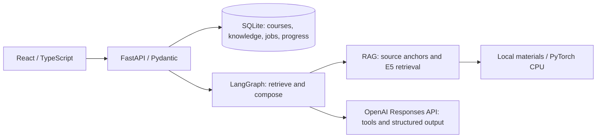

# Personal AI Tutor

A local, Chinese-language study workspace that tracks fine-grained knowledge across courses and adjusts explanations to the learner's prerequisite knowledge. A concept has one shared mastery state, while each course keeps its own learning route, sources, lessons and progress.

## What it does

- Import multiple text PDFs or Markdown files into a course folder; extract new topics and append them to its route. Original files and successful imports survive partial failures.
- Generate a cited, personalized lesson **only when Start learning is clicked**. Identify necessary prerequisites, match them to global concepts, read their latest mastery, then choose the amount of support. Successful lessons are persisted and reused.
- Maintain six editable mastery levels: unknown, aware but unfamiliar, beginner, familiar, proficient, and fully mastered. First completion and subsequent reviews follow deterministic, deduplicated rules shared across courses.
- Select rendered lesson text to ask a follow-up in a side panel, save notes against the original passage, and restore the reading position.
- Generate an optional exercise on demand. Record hints/solution access and grade submitted answers; uncertain evidence does not change mastery.
- Search and filter the global knowledge library locally; initialize optional learning background, edit mastery, and explicitly merge duplicate concepts.

**Mastery is a correctable estimate, not a validated measurement of ability. Reading completion alone is not scientific evidence of mastery.**

## Architecture



FastAPI handles API validation and persistence. LangGraph coordinates retrieval and composition. RAG validates source IDs and retains course/page citations. SQLite stores shared knowledge, task state, lessons, notes and evidence identities. React provides the reader and side panels. **PyTorch runs E5 embedding inference and similarity retrieval; this project does not train a large language model.**

## Run locally

Prerequisites: **Python 3.11**, **Node.js 22.12+ (22.x), or 24+**, npm and [uv](https://docs.astral.sh/uv/getting-started/installation/). `.python-version` pins Python 3.11; `.nvmrc` selects Node 22. The release check also records the exact versions used. Internet access is needed to install dependencies and to download the public `intfloat/multilingual-e5-small` weights on first retrieval.

```sh
git clone https://github.com/wilsonzhang58/personal-ai-tutor.git
cd personal-ai-tutor
uv sync --locked --extra dev
npm --prefix frontend ci
# Preserve an existing local configuration:
test -f backend/.env || cp .env.example backend/.env
uv run --locked uvicorn backend.app.main:app --host 127.0.0.1 --port 8000
```

In a second terminal, from the same repository root:

```sh
npm --prefix frontend run dev -- --host 127.0.0.1
```

Open **http://127.0.0.1:5173/**. Vite proxies `/v1` and `/health` to port 8000. For a separate backend port, set `TUTOR_BACKEND_URL=http://127.0.0.1:<port>` in the frontend terminal and pass `--port <frontend-port>` to the dev command. Stop each server with Ctrl-C.

No separate database download or migration command is needed. On first backend startup, the app creates `data/tutor.db`, applies additive migrations, and seeds two project-authored demo courses from `data/demo/`. Upload and private-folder directories are created when needed. Local settings load from `backend/.env`; explicit process environment values take precedence. Relative SQLite paths resolve from the repository root.

### Try the authored demo — no API key

Keep `TUTOR_DEMO_MODE=1` and leave `OPENAI_API_KEY` empty.

1. Select **最优化：单纯形表** in the course list. Open **我的知识库** to set **初等行变换** to a chosen mastery level before generating a lesson.
2. Select **单纯形表换基**. The reader stays blank until you click **开始学习**. The demo uses local retrieval and visibly deterministic example explanations, with no paid generation.
3. Drag across lesson text and click **提出问题** to open the side panel; try the demo answer and save a note. Reopen the lesson to restore it.
4. **完成学习** explicitly records completion/review. **下一知识点** only navigates. Saved lessons remain unchanged after mastery edits; new questions and other first-time lessons use the latest state.

The demo is a workflow example, not the real model's teaching quality. Automatic route extraction for newly uploaded files and on-demand exercise generation/grading require real model configuration. Upload parsing/storage can succeed without a key, but route creation will report that configuration is needed. E5 still needs its free public model download; it is not bundled in Git.

### Real model mode

Edit only your local `backend/.env`, then restart the backend:

```dotenv
TUTOR_DEMO_MODE=0
OPENAI_API_KEY=your-complete-key
OPENAI_MODEL=gpt-6.2-sol
```

Choose a model available to your API project/provider; the existing integration has been tested with `gpt-6.2-sol`. `OPENAI_BASE_URL` is optional for a compatible provider. **Real API calls incur provider charges.** Route extraction, first-time lessons, follow-ups, exercises, open-answer grading and optional route reordering can make calls. Reopening cached lessons/unfinished exercises, local matching, filters and mastery counters do not require paid generation. Errors are reported without silently switching to demo output.

Use **导入课件** to choose/create a folder and upload files. Use **修改课件** only when parsed text needs correction; it preserves successful lessons and updates affected retrieval content. Private course materials are **not included** in this repository.

## Tests and verification

```sh
uv run --locked pytest -q
npm --prefix frontend test
npm --prefix frontend run build
```

Tests use temporary databases and explicit model fakes; they do not need your private data or an API key. After starting a fresh demo backend, the optional checks below exercise real local E5 retrieval and the teaching policy:

```sh
uv run --locked python -m evals.retrieval
uv run --locked python -m evals.teaching_policy
```

See [verification results](evals/RESULTS.md) for clean-checkout commands and their actual outcomes, [build status](docs/BUILD_STATUS.md) for scope, and [code map](docs/LEARNING_MAP.md) for the files and functions to study. Real-model samples and mocked tests are distinguished; no full browser E2E pass or fixed token-saving percentage is claimed.

## Data and limitations

- Local originals: `private_materials/<course folder>/`; legacy originals: `data/uploads/`. Parsed text, vectors, lessons, notes and progress live in SQLite. Preserve those directories and the database for continued study; do not delete them to upgrade.
- Secrets, personal materials/databases, caches, dependencies and runtime artifacts are ignored by Git. The shipped course text and synthetic policy examples are project-authored examples.
- Single-user local MVP for macOS/Linux; OS file locks use `fcntl`. No authentication or hardened public hosting. Keep the services bound to localhost.
- Text PDFs and Markdown are supported, with a 10 MB/file and 100-page/PDF limit. OCR, exact formula reconstruction, streaming, a complete background curriculum, and comprehensive browser E2E coverage are not implemented. Check important formulas against the original physical page.
- SQLite task state survives navigation; an interrupted backend task requires an explicit retry after restart. Existing successful lessons are immutable; newer material does not automatically rewrite them.
- Mastery thresholds are MVP heuristics. Open-answer scoring and prerequisite matching remain fallible; manual correction is available. Similarity scores are rankings, not probabilities.
