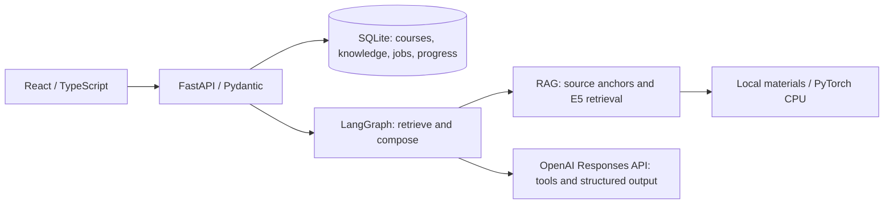

# Personal AI Tutor

A one-to-one AI tutor for self-study that builds on your recorded knowledge across courses, explains the foundations you need, and keeps saved notes beside the lesson.

## Why I built this

In a university classroom, one teacher may teach the same lesson to fifty students with very different starting points. Some have studied optimization; others have not. Some are comfortable with linear algebra; others have forgotten elementary row operations. A shared lecture cannot continually adjust its content, depth and pace to each student's background.

I wanted a private teacher for independent study: one that gradually builds a record of what I have studied, what still feels unfamiliar, and which foundations need a reminder. That understanding should carry into the next lesson and into other courses, while remaining open to correction by the learner.

The long-term goal is a tutor that gets to know a learner's knowledge background over time. This first version implements part of that learning loop; broader knowledge coverage and more accurate background initialization are still work ahead.

## The same lesson, two different starting points

The authored demo includes **最优化：单纯形表** (Optimization: the simplex tableau) and the topic **单纯形表换基** (pivoting a simplex tableau). Both learners below are studying that same new topic:

| Recorded background | How the explanation should change |
|---|---|
| Familiar with **初等行变换** (elementary row operations) | Briefly recall the relevant operation, then focus on what the pivot changes in the simplex method. |
| Unfamiliar with, or has forgotten, row operations | Explain the needed row operation where the pivot calculation uses it, with enough definition and a small example to follow that step. Keep the supplement tied to the current task. |

The current teaching policy turns these records into different support depths. Real-model generation is instructed to add support at the point of use, rather than expanding every prerequisite into another course. The two demo courses share the concept ID `linear_algebra.elementary_row_operations`; another course that uses the same global concept can reuse its knowledge record. The learner can edit that record if the system's estimate is wrong.

**The no-key demo uses deterministic example text to illustrate the policy and workflow.** It can show a short reminder versus a fuller explanation, but it does not reproduce the real model's lesson composition or fine-grained placement. It is not an experiment demonstrating learning gains.

## A reading workflow you can continue

1. **Bring your course material.** Import text PDFs or Markdown into a course folder. The app parses the files and builds or extends that course's learning route; it does not pre-generate all lessons or exercises.
2. **Study one topic when you are ready.** Select a topic and click **开始学习** (Start learning). The teaching flow combines the material with current knowledge records and saves a cited lesson. Reopening it uses the saved snapshot.
3. **Ask from the passage you are reading.** Select rendered lesson text and choose **提出问题** (Ask a question). A side panel keeps the selected passage alongside the exchange, so you can ask a follow-up without replacing the main lesson. Closing the panel restores the reading position captured when it opened.
4. **Keep an explanation worth revisiting.** Review or edit the latest question-and-answer draft, then click **保存到原文** (Save to the passage). The note is attached to the saved lesson block and retains the selected quote and anchor. Reopening the lesson displays notes you explicitly saved beside their related blocks.
5. **Practise and move on.** Request an optional exercise, submit an answer and review feedback. Exercises are generated by the configured model, not retrieved from an online collection of classic problems. **完成学习** (Complete learning) records completion or review; **下一知识点** (Next topic) only navigates.

### What is saved between visits

| Item | Stored behavior and what the reader restores |
|---|---|
| Side-panel exchange on screen | Displayed replies are temporary UI state. Opening a topic clears that view; the UI does not replay the complete conversation after navigation or reload. |
| Submitted questions and answers | The backend automatically stores the question, selection, response result and thread ID in SQLite. New follow-ups use bounded recent thread context and a compact summary. These records are not a full conversation-history view in the reader. |
| Notes you explicitly save | The edited note, selected quote, anchor, lesson ID and block ID are persisted. These saved notes are loaded when that lesson is opened again. Their anchors reference the generated lesson text; source PDFs remain separate. |
| Reading progress | Each course keeps its last saved topic and scroll position. Returning to that course resumes that position; the MVP does not maintain a separate position for every previously visited lesson. |
| Saved lessons | Successful lessons keep their original content and teaching snapshot. Profile edits and supplementary material do not automatically rewrite them. New questions and other first-time lessons read the latest knowledge state. |

## What the current MVP implements

- **A shared, editable knowledge record.** Six mastery levels run from unknown to fully mastered. Courses mapped to the same global concept share its state; course routes, materials and lesson snapshots remain separate. The optional background questionnaire fills missing states from a small predefined foundation seed.
- **Local update rules.** First completion, reviews on distinct valid dates, and qualifying question/exercise evidence follow deterministic rules and daily limits. Repeated requests do not repeatedly count toward progress. Manual correction remains available. Background assumptions do not overwrite existing records.
- **On-demand teaching with durable jobs.** Cached or authored prerequisite links can be reused; otherwise a scoped analysis identifies necessary foundations. Local IDs, aliases, cache and E5 assist matching. Current knowledge records determine support depth before retrieval and generation. Opening a topic alone never schedules a paid generation call.
- **Material-grounded lessons and continued study.** Incremental uploads append new topics and associate supplementary sources with existing ones. Source IDs are validated and course/page citations are retained. Text selection, side-panel follow-ups, explicit notes and course progress connect questions to the reading task.
- **Practice when requested.** Unfinished generated exercises are cached. Hint and solution access are recorded; submitted answers use a local numeric check where applicable or model-based rubric feedback. Uncertain or assisted evidence does not receive an independent-completion reward.
- **A local knowledge library.** Filter by subject, direction and mastery, search names/English names/aliases, change a level inline, or explicitly merge duplicate concepts. Filters and matching do not start a dedicated paid model job.

## How it works

The teaching flow is scoped to the topic the learner chose. It is a retrieval-and-composition workflow, with persistence and deterministic policy around the model calls.



| Component | Role in the learning experience |
|---|---|
| React / TypeScript | Lesson reader, selected-text questions, side panels, note drafts and knowledge controls. |
| FastAPI / Pydantic | Validated API requests, persistent generation jobs and coordination of the study actions. |
| SQLite | Cross-course concept states, source links, saved lessons, submitted turns, notes and last course position. |
| LangGraph | A bounded retrieve → compose workflow for the selected topic. |
| RAG with PyTorch / E5 | CPU embedding inference and similarity retrieval, supplemented by course/topic source anchors. Retrieved source IDs constrain citations. |
| Model API | Scoped prerequisite analysis, lesson and follow-up composition, route extraction, and generated exercises/rubric feedback when configured. |

**PyTorch is used for embedding inference and retrieval; this project does not train a large language model.** See the [code map](docs/LEARNING_MAP.md) for the files and functions behind this flow.

## Run locally

Prerequisites: **Python 3.11**, **Node.js 22.12+ (22.x), or 24+**, npm and [uv](https://docs.astral.sh/uv/getting-started/installation/). `.python-version` pins Python 3.11; `.nvmrc` selects Node 22. The release check also records the exact versions used. Internet access is needed to install dependencies and to download the public `intfloat/multilingual-e5-small` weights on first retrieval.

```sh
git clone https://github.com/wilsonzhang58/personal-ai-tutor.git
cd personal-ai-tutor
uv sync --locked --extra dev
npm --prefix frontend ci
# Preserve an existing local configuration:
test -f backend/.env || cp .env.example backend/.env
uv run --locked uvicorn backend.app.main:app --host 127.0.0.1 --port 8000
```

In a second terminal, from the same repository root:

```sh
npm --prefix frontend run dev -- --host 127.0.0.1
```

Open **http://127.0.0.1:5173/**. Vite proxies `/v1` and `/health` to port 8000. For a separate backend port, set `TUTOR_BACKEND_URL=http://127.0.0.1:<port>` in the frontend terminal and pass `--port <frontend-port>` to the dev command. Stop each server with Ctrl-C.

No separate database download or migration command is needed. On first backend startup, the app creates `data/tutor.db`, applies additive migrations, and seeds two project-authored demo courses from `data/demo/`. Upload and private-folder directories are created when needed. Local settings load from `backend/.env`; explicit process environment values take precedence. Relative SQLite paths resolve from the repository root.

### Try the authored demo — no API key

Keep `TUTOR_DEMO_MODE=1` and leave `OPENAI_API_KEY` empty.

1. Select **最优化：单纯形表** in the course list. Open **我的知识库** to set **初等行变换** to a chosen mastery level before generating a lesson.
2. Select **单纯形表换基**. The reader stays blank until you click **开始学习**. The demo uses local retrieval and visibly deterministic example explanations, with no paid generation.
3. Drag across lesson text and click **提出问题** to open the side panel; try the demo answer and save a note. Reopen the lesson to restore it.
4. **完成学习** explicitly records completion/review. **下一知识点** only navigates. Saved lessons remain unchanged after mastery edits; new questions and other first-time lessons use the latest state.

The demo is a workflow example, not the real model's teaching quality. Automatic route extraction for newly uploaded files and on-demand exercise generation/grading require real model configuration. Upload parsing/storage can succeed without a key, but route creation will report that configuration is needed. E5 still needs its free public model download; it is not bundled in Git.

### Real model mode

Edit only your local `backend/.env`, then restart the backend:

```dotenv
TUTOR_DEMO_MODE=0
OPENAI_API_KEY=your-complete-key
OPENAI_MODEL=gpt-6.2-sol
```

Choose a model available to your API project/provider; the existing integration has been tested with `gpt-6.2-sol`. `OPENAI_BASE_URL` is optional for a compatible provider. **Real API calls incur provider charges.** Route extraction, first-time lessons, follow-ups, exercises, open-answer grading and optional route reordering can make calls. Reopening cached lessons/unfinished exercises, local matching, filters and mastery counters do not require paid generation. Errors are reported without silently switching to demo output.

Use **导入课件** to choose/create a folder and upload files. Use **修改课件** only when parsed text needs correction; it preserves successful lessons and updates affected retrieval content. Private course materials are **not included** in this repository.

## Tests and verification

```sh
uv run --locked pytest -q
npm --prefix frontend test
npm --prefix frontend run build
```

Tests use temporary databases and explicit model fakes; they do not need your private data or an API key. After starting a fresh demo backend, the optional checks below exercise real local E5 retrieval and the teaching policy:

```sh
uv run --locked python -m evals.retrieval
uv run --locked python -m evals.teaching_policy
```

See [verification results](evals/RESULTS.md) for clean-checkout commands and their actual outcomes, [build status](docs/BUILD_STATUS.md) for scope, and [code map](docs/LEARNING_MAP.md) for the files and functions to study. Real-model samples and mocked tests are distinguished; no full browser E2E pass or fixed token-saving percentage is claimed.

## Data, current limits and next improvements

This is a local single-user MVP with relatively simple knowledge, initialization and support-depth rules. **Mastery is a correctable estimate, not a validated diagnosis; reading completion alone does not establish mastery.** Concept matching, formula extraction and model grading can be wrong. The system does not comprehensively know everything the learner has studied, and no guaranteed grade improvement or fixed learning-time saving is claimed.

- **Coverage and background:** the starting curriculum is a small documented subset, not a complete knowledge system. Most concepts begin unknown until a record or supported seed exists. Choosing a broader educational starting level does not initialize an entire syllabus.
- **Material and interface limits:** text PDFs and Markdown are supported, with a 10 MB/file and 100-page/PDF limit. OCR, exact formula reconstruction, streaming and comprehensive browser E2E coverage are not implemented. Check important formulas against the original physical page.
- **Local operation:** macOS/Linux only at present; file locks use `fcntl`. There is no authentication or hardened public hosting. Keep the services bound to localhost. An interrupted backend generation task requires an explicit retry after restart.
- **Data to preserve:** originals live in `private_materials/<course folder>/`, with legacy originals in `data/uploads/`. SQLite holds parsed text, vectors, knowledge states, lessons, submitted question records, saved notes and progress. Keep those directories and `data/tutor.db` to continue studying; do not delete them to upgrade. Secrets and runtime data are ignored by Git; private course material is not shipped here. The included course text and synthetic policy examples are project-authored.

The next improvements follow the original product idea:

1. **Knowledge coverage and concept organization:** build a more useful, connected library while handling shared foundations and ambiguous concepts more carefully.
2. **Background initialization:** make it easier and more accurate for learners to establish and correct their starting knowledge.
3. **Lesson and prerequisite support:** refine how necessary foundations are selected, how much explanation they receive, and where that support appears within the current task.
4. **Passage-linked questions and study records:** improve how learners preserve, revisit and continue useful explanations alongside the material they were reading.
